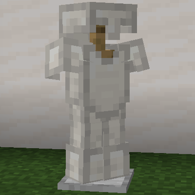
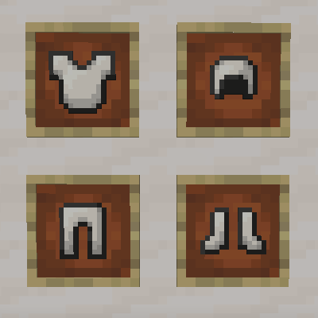

# Quartz Armor

A Fabric mod that adds a full set of armor crafted from smooth quartz blocks. It's a glass-cannon armor tier: the highest protection and toughness in the game, but with durability so low it breaks quickly, trading longevity for raw defense.

## Screenshots

## Features

- Helmet, chestplate, leggings, and boots crafted from smooth quartz blocks using standard vanilla armor crafting patterns
- Highest defense values in the game: more protection per piece than diamond armor
- Higher armor toughness than diamond
- Triple the enchantability of diamond, making these pieces easy to enchant well
- Very low base durability: the tradeoff for the stat boost
- Repairable with smooth quartz blocks
- Accepts armor trims
- Added to the vanilla Combat creative tab

### Armor Stats

| Stat | Quartz | Diamond |
|------|--------|---------|
| Helmet Defense | 4 | 3 |
| Chestplate Defense | 9 | 8 |
| Leggings Defense | 7 | 6 |
| Boots Defense | 4 | 3 |
| **Total Defense** | **24** | **20** |
| Armor Toughness | 3.0 | 2.0 |
| Helmet Durability | 110 | 363 |
| Chestplate Durability | 160 | 528 |
| Leggings Durability | 150 | 495 |
| Boots Durability | 130 | 429 |
| Enchantability | 30 | 10 |

## Pandorical

Quartz Armor goes on the server only, and **Pandorical is required there and on every player's client**: the armor pieces are new items, and a client without Pandorical has no entry for them.

## Development

Installing is in [DEVELOPMENT.md](DEVELOPMENT.md).

## License

MIT, see [LICENSE](LICENSE).
